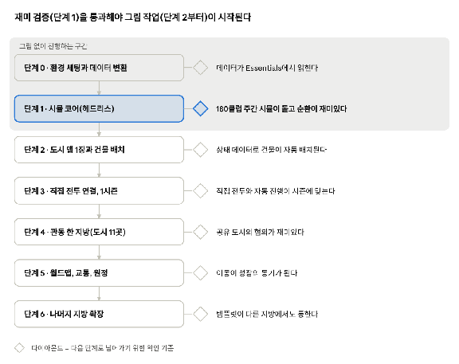

<!-- 포켓 매니저 에센셜 설계 문서 v0.1 에서 분리. 원본은 Google Docs이며 그쪽이 기준이다. 수정은 원본에서 하고 tools/split_design_doc.rb 로 다시 만든다. -->

## **기술 구조와 데이터**

맵과 전투는 Essentials가 맡고, 도시·클럽·재정·협의 시뮬레이션은 맵과 분리된 Ruby 모듈로 두어 게임을 켜지 않고도 수천 주를 돌릴 수 있게 한다.

* **엔진**: Essentials 최신 안정판과 세대 확장 플러그인(알로라·가라르·팔데아 포켓몬과 기술 데이터가 필요하다). 맵 편집에는 RPG Maker XP가 필요하다.  
* **시뮬 코어 분리**: 세계, 도시, 클럽, 트레이너를 다루는 모듈을 맵에서 떼어 내고, 헤드리스로 돌려 밸런스를 검증한다. 포켓 매니저에서 쓰던 시뮬레이션 방식과 같다.  
* **데이터 변환**: 현재 게임의 트레이너 180명과 포켓몬 세트를 Essentials 형식으로 바꾼다. 연고지 배치표는 데이터 파일로 만들어 도시 초기 상태의 기준으로 쓴다.  
* **세이브**: 도시와 클럽 상태를 압축해 저장한다(도시 100곳, 클럽 180개, 부지별 건물과 단계).  
* **이식할 기능**: 업적과 도감(현재 업적 225개, 저장 합산 도감)은 핵심 순환이 안정된 뒤 이식한다.  
* **성능 위험**: 180클럽의 주간 시뮬을 Ruby로 돌릴 때 속도가 느릴 수 있어 단계 1에서 먼저 재야 한다.

## **제작 재료**

가장 큰 작업은 코드가 아니라 그림이고, 시뮬 코어(로드맵 단계 1)는 그림 없이도 만들 수 있다. 그림은 단계 2부터 필요하다. 규모는 대략적인 감이다.

| 분류 | 필요한 것 | 규모 |
| :---- | :---- | :---- |
| 그림 | 통일된 화풍의 타일셋 | 세트 1식(지형별 확장 가능) |
| 그림 | 건물 외관 | 약 20종 × 3단계 |
| 그림 | 지형 배경과 고유 랜드마크 | 배경 8\~10종, 랜드마크 도시당 1\~2개 |
| 그림 | 도시 맵 템플릿 | 1장 |
| 그림 | 트레이너 도트 스프라이트(맵 이동, 전투 정면) | 180명 중 비중 있는 인물부터 |
| 그림 | 월드맵과 UI 그래픽 | 9개 지방 지도 1장 \+ 메뉴 세트 |
| 소리 | 도시, 전투, 리그, 협의 장면 BGM과 효과음 | 지방 공통 위주로 시작 |

**법적 고려**: 배포 범위(비공개 팬게임인지 공개인지)를 먼저 정한다. 참고한 월드맵 그림 2장은 공식 이미지를 이어 붙인 팬 지도라서 개발 중 임시 자리표시로만 쓰고, 배포판에는 지방 배치만 참고해 직접 그리거나 의뢰한 그림으로 바꾼다. 타일셋과 음악도 같은 원칙을 따른다.

## **로드맵**

구현은 7단계로 나누고, 그림 없이 재미를 먼저 검증한 뒤에 맵과 그림 작업에 들어간다.

로드맵 · 7단계와 확인 기준

단계 0\~1은 그림 없이 진행하고, 각 단계의 다이아몬드(확인 기준)를 통과해야 다음 단계로 넘어간다. 단계 1이 가장 중요한 관문이다.

## **위험과 미결 사항**

가장 큰 위험은 그림 작업량과 일정이고, 아래 표에서 위험은 대응 방침을, 미결은 정해야 할 항목을 적었다.

### **위험**

| 위험 | 대응 |
| :---- | :---- |
| 그림 작업량과 일정 | 시뮬 코어를 먼저 검증하고 관동 한 지방으로 수직 슬라이스를 만든다 |
| 180클럽 시뮬 성능 | 단계 1에서 속도를 측정하고 필요하면 계산 빈도를 줄인다 |
| 직접 전투의 템포와 피로 | 자동 진행, 건너뛰기, 속도 옵션을 함께 만든다 |
| 협의 규칙의 복잡도 | 안건을 5종으로 제한하고 거절 이유를 대사로 보여준다 |
| 저작권 | 배포판 그림·음악은 직접 제작 또는 의뢰로 대체하고 배포 범위를 정한다 |
| 두 게임 병행 | 포켓 매니저는 안정화 중심으로 유지한다 |

### **미결 사항**

* 직접 전투 룰(싱글·더블), 엔트리·선봉 지정, 최신 세대 기믹의 지원 범위  
* 포켓몬 특화 건물(연구소, 보호구역 등)의 소유 방식  
* 재정 수치(세율, 대출 한도, 유지비 곡선)와 클럽 부지 칸 수  
* 승리 조건과 엔딩, 실패 조건(재정 파탄, 해고, 도시 쇠퇴)  
* 시즌 달력과 대회 일정(더비 포함)  
* 트레이너 성향 데이터 생성 규칙과 관계도 초기값  
* 도시 위기 이벤트, 인접 배치 시너지, 2칸 건물의 도입 시기  
* 리그 도시의 이름 표기("포켓몬리그(지방)"를 그대로 쓸지 새 이름을 지을지)  
* 배치표의 ★ 트레이너 배정 조정 여부
